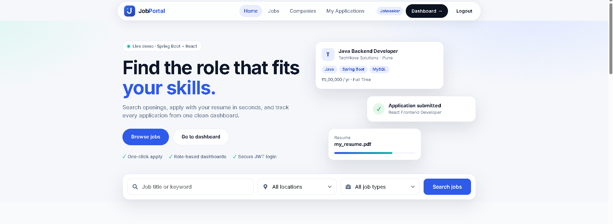
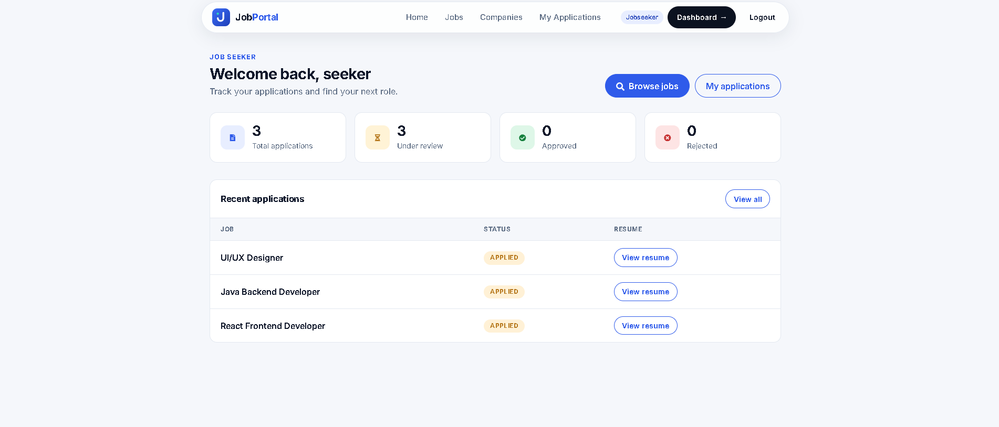
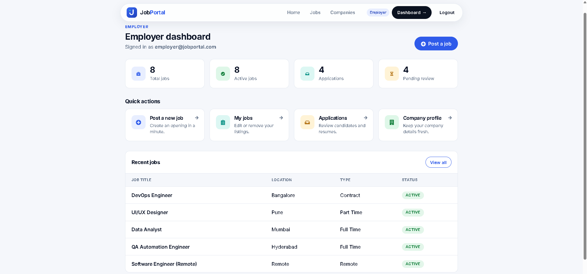
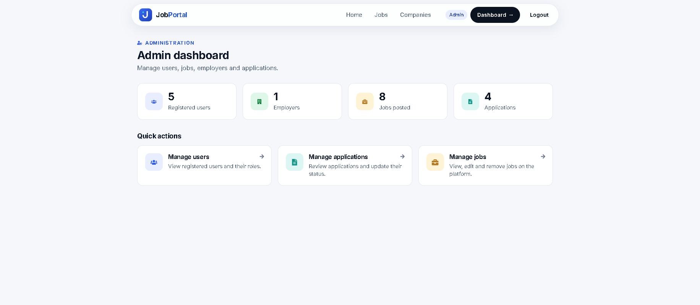
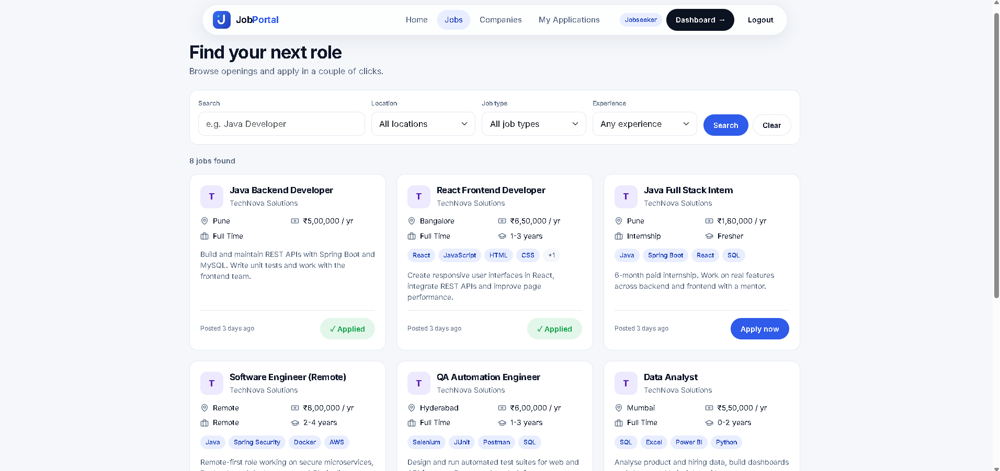
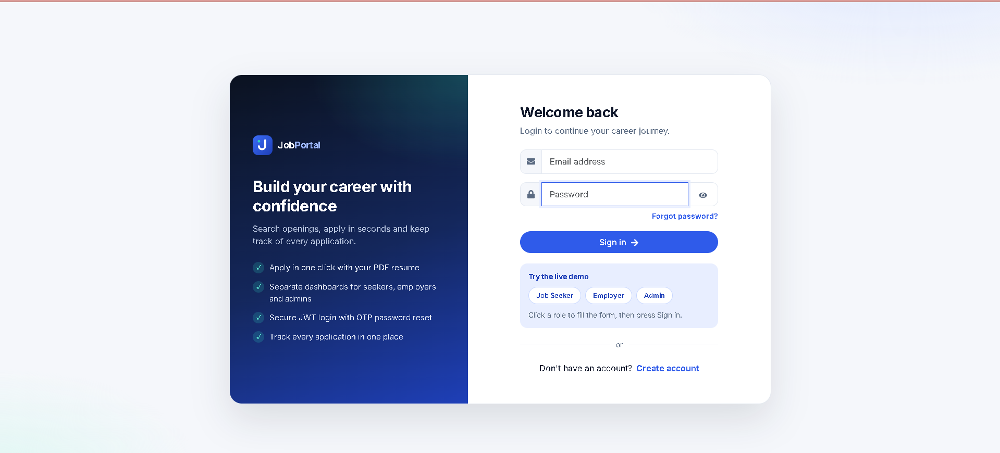
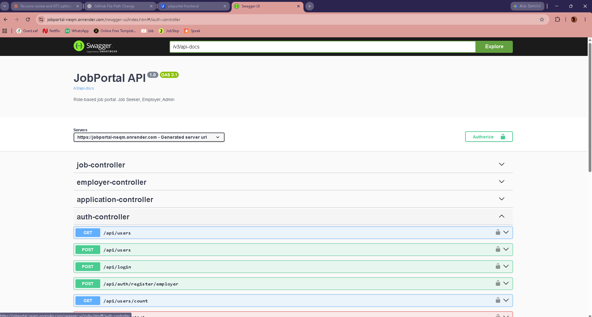
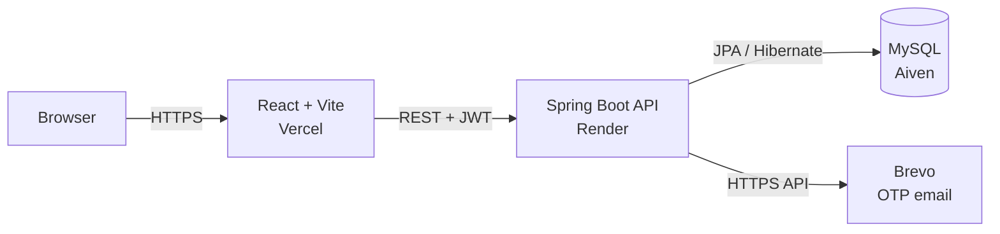
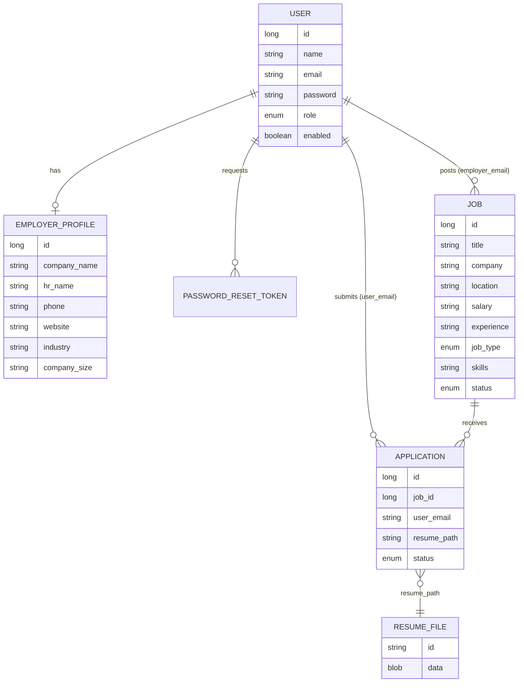

<div align="center">

# 💼 JobPortal

**A full-stack job portal with role-based dashboards for Job Seekers, Employers and Admins.**

[](https://job-portal-six-henna-58.vercel.app)
[](https://jobportal-neqm.onrender.com/swagger-ui.html)
[](https://github.com/Shreyash9330/JobPortal/actions/workflows/ci.yml)


[**Live demo**](https://job-portal-six-henna-58.vercel.app) · [**Swagger API docs**](https://jobportal-neqm.onrender.com/swagger-ui.html) · [**Report a bug**](https://github.com/Shreyash9330/JobPortal/issues)



</div>

> **Heads-up:** the backend runs on Render's free tier, so it sleeps after ~15 minutes of inactivity. The first request can take **30–60 seconds** to wake it up (the UI shows a "Server is waking up" notice). After that it is fast.

## 🔑 Try it in 30 seconds

Open the [live demo](https://job-portal-six-henna-58.vercel.app) → **Login** → click a demo chip, or use:

| Role | Email | Password |
|---|---|---|
| Job Seeker | `seeker@jobportal.com` | `Demo@1234` |
| Employer | `employer@jobportal.com` | `Demo@1234` |
| Admin | `admin@jobportal.com` | `Demo@1234` |

These are shared demo accounts with fake data. Please don't upload personal documents.

## ✨ Features

**Job Seeker**
- Register, log in, reset password with an emailed OTP
- Search jobs by title/keyword, location and job type
- View job details and apply with a PDF resume (duplicate applications blocked)
- Track every application and its status (Applied → Shortlisted → Selected/Rejected) with filter tabs
- Personal dashboard with quick actions

**Employer**
- Register with a company profile; view and edit it
- Post, edit and delete jobs (type, experience, skills, salary, description)
- See applicants per job, open their resumes, approve or reject
- Dashboard with live counts (jobs, applications, pending review)

**Admin**
- View and search all users, delete non-admin users (admins are protected)
- View all applications with status tabs and search
- Platform-wide statistics

**Platform**
- JWT authentication, BCrypt password hashing, role-based authorization (`ADMIN`, `EMPLOYER`, `JOBSEEKER`)
- Ownership checks (`AccessGuard`): users can only read/modify their own data unless they are admin
- Resumes are validated (PDF only, `%PDF` signature check, 2 MB limit) and stored in the database, so they survive free-tier restarts
- Password reset OTP delivered through the Brevo email API (10-minute expiry)
- Global exception handling with consistent JSON errors
- Responsive UI (tested down to 320 px), loading, empty and error states

## 🖼️ Screenshots

| Job Seeker dashboard | Employer dashboard |
|---|---|
|  |  |

| Admin dashboard | Browse jobs |
|---|---|
|  |  |

| Login | Swagger API docs |
|---|---|
|  |  |

## 🛠️ Tech stack

| Layer | Technology |
|---|---|
| Frontend | React 19, Vite, React Router, Axios, Bootstrap 5, React Icons, SweetAlert2 |
| Backend | Java 17, Spring Boot 4, Spring MVC, Spring Security, Spring Data JPA (Hibernate), Bean Validation |
| Auth | JWT (jjwt), BCrypt |
| Database | MySQL 8 |
| API docs | springdoc-openapi (Swagger UI) |
| Email | Brevo transactional email API |
| Testing | JUnit 5, Mockito, Spring MVC Test, JaCoCo |
| DevOps | Docker, Docker Compose, GitHub Actions |
| Hosting | Vercel (frontend), Render (backend), Aiven (MySQL) |

## 🏗️ Architecture



Backend layers: `controller → service → repository → entity`, with `dto`, `security` (JWT filter, `AccessGuard`), `exception` (global handler) and `config` packages.

### Data model



### Security model

| Area | Who can access |
|---|---|
| Browse jobs, job details, login, register, forgot/reset password | Public |
| Apply, upload resume, my applications | `JOBSEEKER` (own data only) |
| Post/edit/delete jobs, applicants, approve/reject, company profile | `EMPLOYER` (own data only) |
| All users, all applications, delete users | `ADMIN` |

Unauthenticated requests get `401`, authenticated-but-forbidden requests get `403`. This is covered by `SecurityRulesTest`.

## 🔗 API overview

Full interactive docs: **[Swagger UI](https://jobportal-neqm.onrender.com/swagger-ui.html)**. Use the **Authorize** button and paste the token returned by `/api/login`.

| Group | Endpoints |
|---|---|
| Auth | `POST /api/login`, `POST /api/users`, `POST /api/auth/register/employer`, `POST /api/auth/forgot-password`, `POST /api/auth/reset-password` |
| Users | `GET /api/users`, `GET /api/users/count`, `DELETE /api/users/{id}` |
| Jobs | `GET /api/jobs`, `GET /api/jobs/filter`, `GET /api/jobs/{id}`, `POST /api/jobs`, `PUT /api/jobs/{id}`, `DELETE /api/jobs/{id}`, `GET /api/jobs/employer/{email}`, `GET /api/jobs/count` |
| Applications | `POST /api/applications`, `POST /api/applications/upload`, `GET /api/applications/resume/{file}`, `GET /api/applications/user/{email}`, `GET /api/applications/employer/{email}`, `GET /api/applications/check`, `PUT /api/applications/{id}/status` |
| Employer | `GET /api/employer`, `GET /api/employer/profile/{email}`, `PUT /api/employer/{id}`, `DELETE /api/employer/{id}` |
| Stats | `GET /api/stats` (public counts for the home page) |

## 🚀 Run locally

**Prerequisites:** Java 17, Node.js 20+, MySQL 8 (or Docker), Git.

```bash
git clone https://github.com/Shreyash9330/JobPortal.git
cd JobPortal
```

### Option A: Docker Compose (backend + MySQL)

```bash
cp .env.example .env        # then edit DB_PASSWORD and JWT_SECRET
docker compose up --build
```

The API is at `http://localhost:8080`, MySQL on host port `3307`. Start the frontend as shown below.

### Option B: Run everything manually

**1. Database**

```sql
CREATE DATABASE jobportal;
```

**2. Backend**

```bash
cd backend
export DB_PASSWORD=your_mysql_password
export JWT_SECRET=a-random-string-of-at-least-32-characters
./mvnw spring-boot:run          # Windows (cmd): set the variables with `set`, then mvnw.cmd spring-boot:run
```

Tables are created automatically by Hibernate (`ddl-auto=update`).

**3. Frontend** (new terminal)

```bash
cd frontend/jobportal-frontend
npm install
npm run dev
```

Open `http://localhost:5173`. By default the frontend talks to `http://localhost:8080`.

### Load demo data (optional)

Creates the three demo users, a company profile and sample jobs. Safe to run more than once.

```bash
mysql -u root -p jobportal < seed.sql
```

### Run the tests

```bash
cd backend
./mvnw test
```

The suite has ~45 tests across services, password reset, resume storage and security rules (401/403/role checks).

## ⚙️ Environment variables

**Backend**

| Variable | Required | Description |
|---|---|---|
| `DB_URL` | no | JDBC URL, default `jdbc:mysql://localhost:3306/jobportal` |
| `DB_USERNAME` | no | default `root` |
| `DB_PASSWORD` | yes | Database password |
| `JWT_SECRET` | yes | Secret for signing JWTs (32+ random characters) |
| `APP_CORS_ALLOWED_ORIGINS` | no | Comma-separated allowed frontend origins |
| `BREVO_API_KEY` | no | Enables real OTP emails. If empty, the OTP is written to the server log |
| `MAIL_FROM` | no | Verified sender address in Brevo |
| `PORT` | no | Server port, default `8080` |

**Frontend**

| Variable | Description |
|---|---|
| `VITE_API_URL` | Backend base URL, e.g. `https://jobportal-neqm.onrender.com` |

Never commit real secrets. `.env` files are git-ignored.

## ☁️ Deployment

| Part | Service | Notes |
|---|---|---|
| Frontend | Vercel | Root directory `frontend/jobportal-frontend`, `VITE_API_URL` set, SPA rewrite in `vercel.json` |
| Backend | Render (Docker) | Auto-deploys on push to `main`, env vars set in the dashboard |
| Database | Aiven MySQL | Connection details provided to Render through environment variables |

## 📁 Project structure

```text
JobPortal/
├── backend/
│   ├── Dockerfile
│   ├── pom.xml
│   └── src/
│       ├── main/java/com/shreyash/jobportal/
│       │   ├── config/  controller/  dto/  entity/  enums/
│       │   ├── exception/  repository/  security/  service/ (+ impl/)
│       └── test/
├── frontend/jobportal-frontend/
│   └── src/
│       ├── components/  pages/{admin,auth,employer,jobseeker}/
│       ├── services/  styles/  utils/
├── docs/screenshots/
├── docker-compose.yml
├── seed.sql
└── .env.example
```

## 🧭 Roadmap

- [ ] Pagination and sorting on job and application lists
- [ ] Email notifications when an application status changes
- [ ] Saved/bookmarked jobs for job seekers
- [ ] Refresh tokens and token revocation
- [ ] Integration tests with Testcontainers

## 👤 Author

**Shreyash Gawande**, Java Full Stack Developer, Pune.

[GitHub](https://github.com/Shreyash9330) · [LinkedIn](https://linkedin.com/in/shreyash-gawande9330)

If this project helped you, consider giving it a ⭐.
